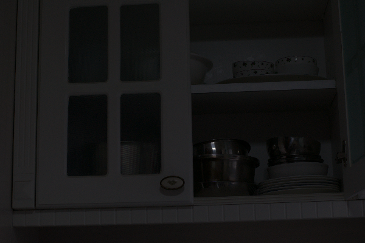
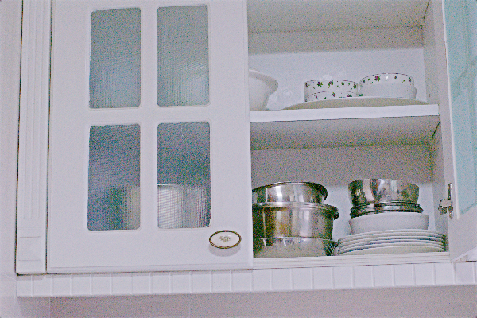
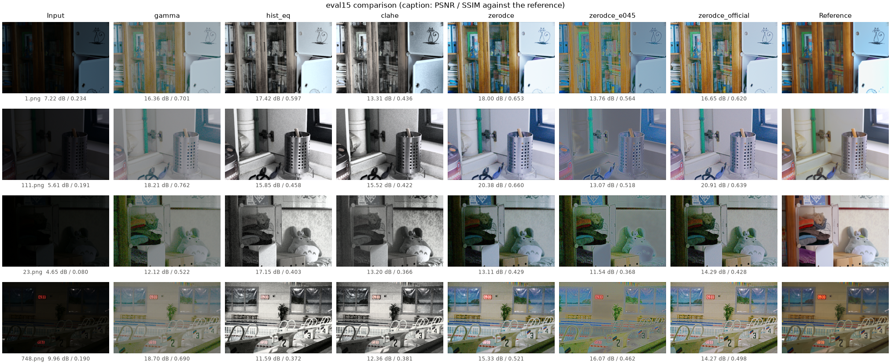
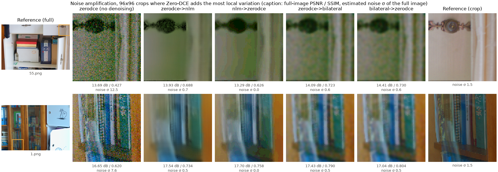
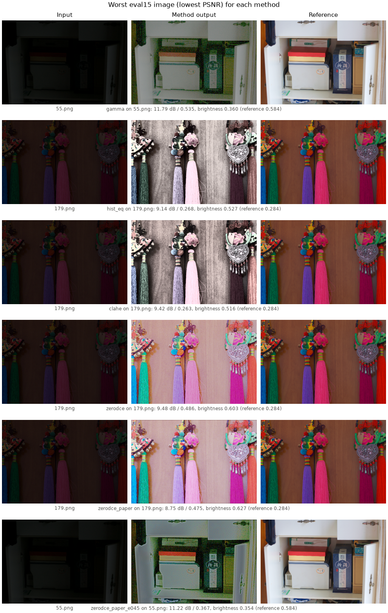

# Low-Light Image Enhancement

[](https://github.com/mansiattrii/Low-Light-Image-Enhancement/actions/workflows/ci.yml)

Brightens very dark photos and compares classical image processing (gamma correction, histogram
equalization, CLAHE) with **Zero-DCE**, a 79k-parameter network implemented from its paper and
trained without any well-lit reference images. Everything is measured on the LOL dataset with
PSNR and SSIM, a denoising study checks where in the pipeline noise removal belongs, and the
result is served through a REST API, a Streamlit demo and a CPU-only Docker image.

**Live demo:** <https://zerodce-low-light.streamlit.app/> (Streamlit Community Cloud, CPU; the
first visit after idle time takes a minute to wake up). It opens with a bundled sample, so there
is nothing to upload:

| Input (LOL eval15 image 79, `assets/sample_low.png`) | Zero-DCE (default model, no denoising) |
|---|---|
|  |  |



## Run it

Streamlit demo locally (after [Setup](#setup-windows-powershell)):

```powershell
streamlit run app.py                     # http://localhost:8501
```

FastAPI service in Docker (CPU-only image, no local Python needed):

```powershell
docker build -t low-light-enhancement .
docker run --rm -p 8000:8000 low-light-enhancement     # docs at http://localhost:8000/docs
curl.exe -F "file=@assets/sample_low.png" -F "method=zerodce" -F "denoise=true" http://localhost:8000/enhance -o out.png
```

Tests (synthetic images only; no dataset or GPU needed):

```powershell
pytest
```

## Results at a glance

LOL eval15 (15 test images, 600×400). Parameters were chosen on a separate validation split;
eval15 was never used to choose anything. Mean ± standard deviation over images.

| Method | PSNR (dB) ↑ | SSIM ↑ | CPU ms / image | Learned params |
|---|---|---|---|---|
| Input (no enhancement) | 7.77 ± 2.62 | 0.195 | – | 0 |
| Gamma correction (γ = 0.25, tuned) | 16.87 ± 2.83 | **0.634** | 4–11 | 0 |
| Histogram equalization (luma) | 14.24 ± 3.14 | 0.419 | 4–11 | 0 |
| CLAHE (tuned) | 14.20 ± 1.77 | 0.392 | 4–11 | 0 |
| **Zero-DCE** (default model) | **16.88 ± 3.55** | 0.525 | 210–430 | 79,416 |
| Zero-DCE + bilateral denoising | **17.82 ± 4.06** | **0.745** | Zero-DCE + ~1 | 79,416 |

Full tables: [results/results.md](results/results.md) and
[results/denoise/denoise_results.md](results/denoise/denoise_results.md). CPU times are ranges
because timing on a laptop varies between runs; Zero-DCE takes 12–16 ms on an RTX 3060.

What the numbers say:

- **Zero-DCE ties the tuned gamma curve on PSNR and loses on SSIM.** Gamma's one parameter was
  tuned against reference images; Zero-DCE never saw a reference during training. Zero-DCE adapts
  per pixel, so it wins clearly on some images and loses on others (larger spread).
- **Brightening amplifies sensor noise.** Zero-DCE's outputs carry about five times the estimated
  noise of the reference photos (9.9 vs 1.9 intensity levels). Adding a bilateral filter after
  enhancement improves both PSNR and SSIM on all 15 images.
- **Before or after enhancement makes almost no difference to the scores** (0.01–0.10 dB), but
  denoising the dark image first causes visible banding.
- **The metrics reward blur.** The best-scoring denoised outputs are smoother than the reference
  photos and lose fine texture.



## How Zero-DCE works

Instead of predicting the bright image directly, the network predicts a **brightening curve for
every pixel**:

```
LE(x) = x + α · x · (1 − x)      with α in [−1, 1], applied 8 times
```

- The curve keeps values in [0, 1] and preserves the order of intensities, so nothing is clipped
  and neighbouring pixels keep their contrast.
- Applying it 8 times, each with its own α map, gives a high-order curve that can lift very dark
  pixels strongly while barely moving bright ones.
- **DCE-Net** is 7 convolution layers (32 channels, no pooling or normalization, skip
  connections) that output 8 × 3 = 24 α maps. It has 79,416 parameters and runs on any image size.

It trains **without reference images**, using four losses that describe a well-exposed image:

1. **Spatial consistency:** local contrast in the output matches the input.
2. **Exposure control:** every 16×16 patch has mean brightness close to 0.6.
3. **Colour constancy:** the average R, G and B are equal (Gray-World).
4. **Illumination smoothness:** neighbouring pixels get similar curves.

## Findings worth knowing

**The paper's equations alone did not train well.** With the loss equations as printed in the
paper, validation PSNR peaked at epoch 2 and then fell for 200 epochs while the training loss kept
improving. A diagnostic that removes brightness and colour errors showed the problem was
structure: hazy, haloed images. The cause is the smoothness term, which is about 80–160× weaker in
the printed equations than in the official code. The default model uses the official code's
formulation (it trains stably, best epoch 14). The paper version is still implemented, trained,
tested and reported as `zerodce_paper`.

**Where each method fails** ([results/failure_cases.md](results/failure_cases.md)):



- Gamma: one exponent for every image, so the darkest scene (55.png) stays too dark.
- Histogram equalization, CLAHE and Zero-DCE all fail on 179.png, a scene whose reference is
  genuinely dark. They brighten it to roughly twice the reference brightness, and Zero-DCE's
  Gray-World loss turns a brown wall pink. These failures come from the methods' built-in
  assumptions, not from bugs.

Plain-language explanations of every decision, the alternatives I rejected, and likely interview
questions are in [NOTES.md](NOTES.md).

## Limitations

- **15 test images.** Differences under about 1 dB are within the image-to-image variation.
- **PSNR and SSIM need a reference** and favour matching the reference's brightness. They cannot
  score real photos and do not fully agree with human judgement (see the blur finding above).
- **Trained on LOL only** (450 images, mostly indoor). The paper used the SICE multi-exposure set,
  so the numbers are not comparable with the paper's, and the model has never seen over-exposed
  input.
- **Checkpoint selection uses references.** Training is zero-reference, but the best epoch was
  chosen by validation PSNR on 35 reference images.
- **The demo's denoising strength** is the PSNR-tuned value, which over-smooths. It can be changed
  in `config.yaml` (`inference.denoise`).

## Project structure

```
src/
  data.py        LOL pairs, image decoding/encoding, train/validation split
  classical.py   gamma, histogram equalization, CLAHE, denoising filters, tuning
  zerodce.py     curve, DCE-Net, model loading and inference
  losses.py      the four zero-reference losses (paper and official formulations)
  train.py       training loop with validation, checkpoints and resume
  evaluate.py    PSNR/SSIM/timing evaluation and results tables
  figures.py     comparison grid, failure cases, checkpoint comparison
  analysis.py    checkpoint drift diagnostic
  denoise.py     denoising study
  enhance.py     single inference function used by the CLI, evaluation, API and demo
  api.py         FastAPI service
app.py           Streamlit demo
config.yaml      every setting (paths, grids, model, training, inference)
weights/         trained Zero-DCE weights (default + two variants)
assets/          sample low-light image bundled with the demo, and its Zero-DCE output
results/         tables, per-image scores, figures, training logs
tests/           105 tests on synthetic images (no dataset or GPU needed)
deploy/          Hugging Face Space card and preparation script (optional, see Deploying)
notebooks/       Colab training notebook
NOTES.md         design decisions and interview notes, milestone by milestone
```

## Setup (Windows, PowerShell)

```powershell
py -3.11 -m venv .venv
.\.venv\Scripts\Activate.ps1
python -m pip install --upgrade pip
pip install -r requirements-dev.txt
```

`requirements.txt` has what the project needs to run; `requirements-dev.txt` adds pytest, ruff
and httpx. `requirements.txt` names `https://download.pytorch.org/whl/cpu` as an extra index so
that pip picks the CPU-only PyTorch wheel on Linux too (the default Linux wheel bundles CUDA and
is several GB); the Dockerfile and CI install it explicitly as well. CPU inference is all the demo
and API need. To train on an NVIDIA GPU, replace it with the CUDA build of the same version (check
`nvidia-smi` for the CUDA version your driver supports):

```powershell
pip install --force-reinstall --no-deps torch==2.14.1 --index-url https://download.pytorch.org/whl/cu132
python -c "import torch; print(torch.cuda.is_available())"
```

## Dataset

The demo, API and tests do not need the dataset. To reproduce the results, download LOL (v1)
from the [official project page](https://daooshee.github.io/BMVC2018website/) and place it as:

```
data/LOL/our485/low/*.png   data/LOL/our485/high/*.png   (485 training pairs)
data/LOL/eval15/low/*.png   data/LOL/eval15/high/*.png   (15 test pairs)
```

35 training pairs are held out for validation; their filenames are listed in
`data/splits/val.txt`. Final results are reported only on eval15.

## Reproducing the results

```powershell
python -m src.classical                 # tune classical baselines on the validation split
python -m src.evaluate                  # evaluate on eval15 -> results/results.md
python -m src.evaluate --split val      # evaluate on the validation split
python -m src.figures                   # comparison grid, failure cases, checkpoint comparison
python -m src.analysis                  # best-vs-last checkpoint diagnostic (needs checkpoints/)
python -m src.denoise                   # denoising study -> results/denoise/denoise_results.md
python -m src.enhance --input dark.jpg --output out.png --method zerodce [--denoise]
pytest
ruff check .; ruff format --check .
```

All settings live in `config.yaml`.

### Training Zero-DCE

Zero-DCE is trained with zero-reference losses on the LOL low-light images only; the normal-light
images are used for validation PSNR and evaluation.

The weights in `weights/` were trained locally on an RTX 3060 (200 epochs, 10–18 s per epoch):

```powershell
# weights/zerodce.pth (default): loss formulas and weights of the official implementation
python -m src.train --device cuda --num-workers 0 --output-dir checkpoints/zerodce_official
# weights/zerodce_paper.pth: the paper's printed loss equations and weights
python -m src.train --device cuda --num-workers 0 --loss-formulation paper --output-dir checkpoints/zerodce_e060
# weights/zerodce_e045.pth: paper equations with exposure level 0.45 (ablation)
python -m src.train --device cuda --num-workers 0 --loss-formulation paper --exposure-level 0.45 --output-dir checkpoints/zerodce_e045
```

Without a GPU, use Google Colab: open `notebooks/train_colab.ipynb`, set `REPO_URL`, upload
`LOL.zip` to `MyDrive/low-light-enhancement/`, and run all cells. If the session disconnects, run
all cells again: training resumes from the last checkpoint on Drive. A short CPU run for checking
the setup:

```powershell
python -m src.train --epochs 2 --device cpu --num-workers 0 --output-dir checkpoints/cpu_check
```

## Web API and demo

```powershell
uvicorn src.api:create_app --factory --port 8000   # API; docs at http://localhost:8000/docs
streamlit run app.py                                # demo at http://localhost:8501
```

| Endpoint | Description |
|---|---|
| `GET /health` | `{"status": "ok"}` |
| `GET /methods` | available methods and the default |
| `POST /enhance` | multipart form: `file` (image), `method` (`zerodce`, `gamma`, `clahe`, `hist_eq`; default `zerodce`), `denoise` (`true`/`false`). Returns a PNG with `X-Processing-Time-Ms` and `X-Output-Size` headers. |

```powershell
curl.exe -F "file=@dark.jpg" -F "method=zerodce" -F "denoise=true" http://localhost:8000/enhance -o out.png
```

Uploads above 20 MB are rejected (413), files that are not images give 400, and an unknown method
gives 422. Images whose longer side exceeds 2048 pixels are downscaled. `denoise` applies the
bilateral filter after enhancement, the best option in the denoising study.

## Docker

The image uses CPU-only PyTorch and contains only the code, config and default weights. It runs
the API by default, or the demo with `APP=demo`.

```powershell
docker build -t low-light-enhancement .
docker run --rm -p 8000:8000 low-light-enhancement                # API
docker run --rm -p 8501:8501 -e APP=demo low-light-enhancement    # demo
```

## Continuous integration

`.github/workflows/ci.yml` runs on every push to `main` and on pull requests: ruff (lint and
format), the test suite on CPU, then a Docker build with a smoke test that sends a real image to
the API inside the container and checks that the demo mode starts. The badge at the top shows the
latest result on `main`.

## Deploying the demo

### Streamlit Community Cloud (used for the live demo)

Free for public GitHub repositories and needs no extra files: the app is `app.py`, the weights and
the sample image are in the repository, and `requirements.txt` already selects the CPU PyTorch
wheel. On [share.streamlit.io](https://share.streamlit.io) sign in with GitHub, choose **Create
app → Deploy a public app from GitHub**, enter the repository, branch `main` and main file
`app.py`, and set **Advanced settings → Python version** to 3.11. The first build takes a few
minutes; later pushes to `main` redeploy automatically. The free tier puts the app to sleep after
a period without visitors, so the first request afterwards is slow.

### Hugging Face Spaces (alternative)

The Space runs the same Dockerfile, switched to the Streamlit demo. As of November 2026 Docker
and Gradio Spaces require a PRO subscription even on the free CPU hardware; only static Spaces
are free.

1. On [huggingface.co](https://huggingface.co), create a **New Space**: SDK **Docker**, template
   **Blank**, hardware **CPU basic**.
2. Create an access token with **write** permission (Settings → Access Tokens). Git asks for it
   as the password when you push.
3. Clone the Space next to this project and copy the files into it:

   ```powershell
   git lfs install
   git clone https://huggingface.co/spaces/<user>/<space> ..\low-light-space
   powershell -ExecutionPolicy Bypass -File .\deploy\huggingface\prepare_space.ps1 -Destination ..\low-light-space -RepoUrl https://github.com/<user>/<repo>
   ```

   The script copies the files from the **last commit** (commit first), writes the Space card
   from `deploy/huggingface/README.md`, appends the demo settings to the Dockerfile, and makes
   sure the weights are stored with Git LFS, which the Hub requires for binary files.
4. Push:

   ```powershell
   cd ..\low-light-space
   git add -A
   git commit -m "Deploy low-light enhancement demo"
   git push
   ```

5. The Space builds the image (several minutes; progress in the **Logs** tab) and then serves the
   demo.

## References

- C. Guo, C. Li, J. Guo, C. C. Loy, J. Hou, S. Kwong, R. Cong. *Zero-Reference Deep Curve
  Estimation for Low-Light Image Enhancement.* CVPR 2020.
  [arXiv:2001.06826](https://arxiv.org/abs/2001.06826),
  [official code](https://github.com/Li-Chongyi/Zero-DCE).
- C. Wei, W. Wang, W. Yang, J. Liu. *Deep Retinex Decomposition for Low-Light Enhancement.*
  BMVC 2018 (the LOL dataset).
- Z. Wang, A. C. Bovik, H. R. Sheikh, E. P. Simoncelli. *Image Quality Assessment: From Error
  Visibility to Structural Similarity.* IEEE TIP 2004 (SSIM).
- A. Buades, B. Coll, J.-M. Morel. *A Non-Local Algorithm for Image Denoising.* CVPR 2005.
- C. Tomasi, R. Manduchi. *Bilateral Filtering for Gray and Color Images.* ICCV 1998.
